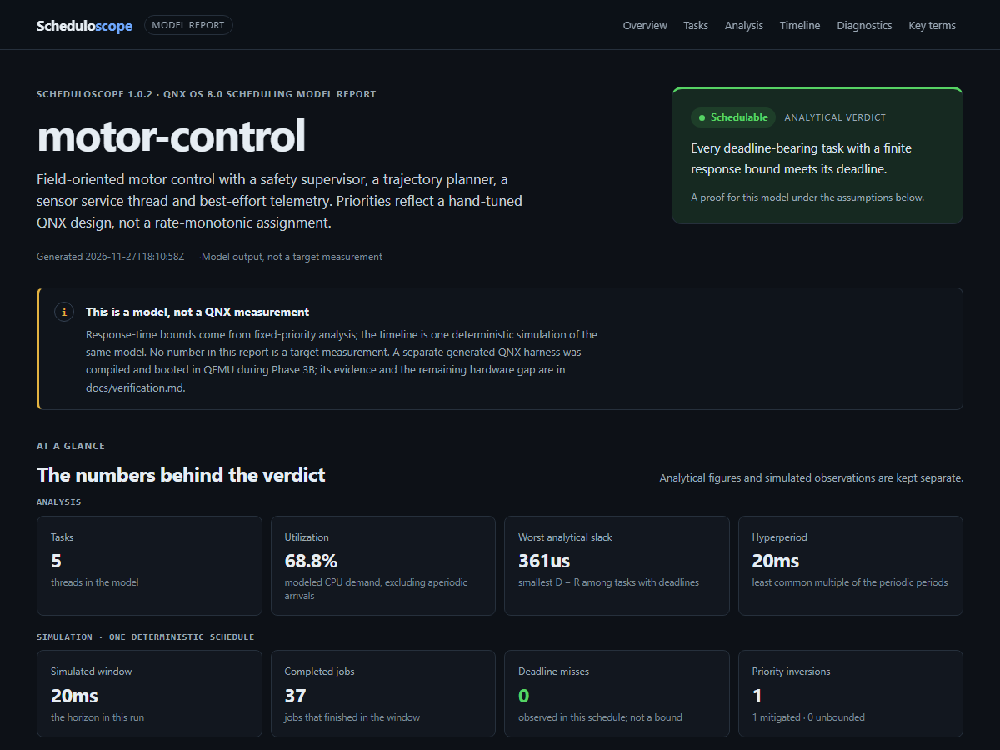

# Scheduloscope

**Find the timing bugs in a QNX 8.0 design before the hardware does.**

[](https://github.com/fetachino/qnx-scheduloscope/actions/workflows/ci.yml)
[](LICENSE)
[](package.json)
[](docs/qnx-semantics.md)

Scheduloscope is a design-time scheduling analyzer and deterministic simulator for QNX OS 8.0
systems, plus a generator that turns the same model into a C workload intended for measuring those
estimates on a real QNX target once built with the QNX SDP.



[Project site](https://fetachino.github.io/qnx-scheduloscope/) · [Open the generated report](https://fetachino.github.io/qnx-scheduloscope/demo/motor-control.html) — one self-contained HTML file, no server, no
build step.

Or take the [four-minute demo tour](docs/demo-tour.md): baseline, one attribute changed, deadline
miss, the inversion in the chart, and how the generated harness is designed to measure it on the
target.

---

## The problem

On a QNX system the hardest bugs are not logic bugs, they are timing bugs: a control loop that
misses its deadline once a minute, a servo that jitters when the logger starts, a driver that
blocks a safety thread for 900 microseconds because a mutex was created with the wrong protocol.
None of these reproduce on a development machine, and by the time a tracelog shows the pattern
the product is on a vehicle.

QNX gives you excellent run-time tools (`tracelogger`, `pidin`, `hogs`, `aps`) but they all need
the target. The design decisions that cause the problem - priority assignment, mutex protocol,
message-passing topology, interrupt thread priorities, sporadic budgets - are made long before
the first trace. Scheduloscope attacks that gap:

1. **Analyze** - response-time analysis (RTA) with QNX-specific blocking, inheritance and
   interrupt terms. It answers *can this task set meet its deadlines, and if not, which term*
   *is responsible*.
2. **Simulate** - a deterministic discrete-event model of QNX scheduling semantics that shows
   *when* it fails, not just whether: a Gantt chart of every context switch, every priority
   inversion, every sporadic budget exhaustion.
3. **Measure** - generate a C harness for the same model, intended to run on the target with
   `SCHED_FIFO` / `SCHED_RR` / `SCHED_SPORADIC`, `ClockCycles`, priority-inheriting mutexes and
   real `ChannelCreate` message passing, and report measured worst-case response times once
   executed.

## Why this is QNX-specific

| Concern | How Scheduloscope models it |
| --- | --- |
| Priority space | 0 idle, 1..63 unprivileged, 64..253 need `PROCMGR_AID_PRIORITY`, 254 clock IST, 255 IPI. The validator flags a design that silently needs a privilege it will not have. |
| Mutex protocols | `PTHREAD_PRIO_NONE`, `PTHREAD_PRIO_INHERIT` (the QNX default), `PTHREAD_PRIO_PROTECT` with a ceiling; blocking terms differ per protocol. |
| Message-driven inheritance | A server inherits the priority of the client it is serving at `MsgSend()`, and **keeps it after `MsgReply()`** (sticky). `_NTO_CHF_FIXED_PRIORITY` turns both off. |
| Sporadic servers | `SCHED_SPORADIC` with `sched_ss_low_priority`, `sched_ss_init_budget`, `sched_ss_repl_period`, `sched_ss_max_repl`: run at low priority once the budget is gone, replenish on the period. |
| Round robin | Timeslice is ticks x `ClockPeriod()` (4 x 1 ms by default); peers at the same priority share the CPU only within that slice. |
| Interrupt threads | ISR entry overhead plus an IST at a priority high in the 1..255 space; a rate-monotonic task set with a 254-priority IST is not schedulable in the same way as one without. |
| Context switches | Each job pays the dispatch cost; the simulator counts switches so you can see the cost of the design, not just the total CPU. |

## Quick start

```bash
git clone https://github.com/fetachino/qnx-scheduloscope.git
cd qnx-scheduloscope
npm install
npm run build

# analyze the example motor controller
npx scheduloscope analyze examples/motor-control.yaml

# see the schedule, then write a self-contained HTML report
npx scheduloscope simulate examples/motor-control.yaml
npx scheduloscope report examples/motor-control.yaml --out demo/
```

Requires Node 20.11 or newer. No QNX SDK is needed to analyze or simulate; the SDK is only
needed to build the generated harness with `qcc`.

## A model

Models are YAML and read like a design document. Durations are whole microseconds; every
segment is either pure CPU, a critical section, a message round trip, or a sleep.

```yaml
schema: scheduloscope/v1
name: motor-control

cpu:
  cores: 1
  contextSwitchUs: 2
  privilegedPriorityCeiling: 63

clock:
  periodUs: 1000
  roundRobinTimesliceTicks: 4

interrupts:
  entryOverheadUs: 2
  sources:
    - name: adc
      period: 500us
      service: 24us

resources:
  - name: stateLock
    protocol: inherit        # QNX default

channels:
  - name: sensorHub
    serverThreads: 1
    basePriority: 45
    handler:
      - cpu: 40us

tasks:
  - name: control
    priority: 60
    period: 1ms
    deadline: 1ms
    segments:
      - cpu: 150us
      - rpc:
          channel: sensorHub
          timeout: 2ms
      - cpu: 120us
      - cs:
          resource: stateLock
          work: 60us
```

See [docs/model-reference.md](docs/model-reference.md) for every field, and the four examples in
[`examples/`](examples): a schedulable design, the same design with one attribute changed, an
unbounded inversion that misses, and a sporadic reader with a CPU budget.

## Commands

| Command | What it does |
| --- | --- |
| `check` | Parse and validate only. Exit 0 clean, 1 with errors. |
| `analyze` | Response-time analysis plus diagnostics. Exit 1 when the set is unschedulable. |
| `simulate` | Deterministic simulation: per-task response times, inversions, misses. |
| `report` | Markdown and a self-contained HTML report with an inline SVG Gantt chart. |
| `gen` | QNX 8.0 measurement harness: `workload.h`, `workload_config.h`, `harness.c`, `platform_qnx.c`, `platform_posix.c`, `Makefile`, `image.build.template`, `README.md`. |
| `init` | Write a commented starter model. |

Useful flags: `--json` for machine-readable output, `-d 200ms` for the window, `--seed` for the
aperiodic arrivals, `-o` for output paths. `scheduloscope --help` lists everything.

Exit codes: `0` schedulable, `1` errors or a missed deadline, `2` usage error. That makes
`scheduloscope check model.yaml` usable as a pre-commit or CI gate.

## What it does on the examples

`examples/motor-control.yaml` - five threads, one service channel, one ISR:

```text
motor-control  schedulable  |  5 tasks  |  68.8% utilization  |  worst slack 361us  |  hyperperiod 20ms

task     policy  pri        C      B        I    ISR        R     D     slack  result
safety   fifo     70    124us  100us      0ns   26us    250us   2ms   1.75ms  met
control  fifo     60    364us  100us    124us   51us    639us   1ms    361us  met
```

The simulation of the same model over 20 ms shows 88 context switches and one 82 us inversion,
correctly reported as *mitigated*: the logger holds `stateLock`, the safety thread blocks on it,
the logger inherits priority 70 and finishes, and no deadline is missed.

`examples/motor-control-no-inherit.yaml` - the same file with one functional edit, `protocol: none`
on `stateLock`:

```text
motor-control-no-inherit  inconclusive  |  5 tasks  |  68.8% utilization  |  worst slack 361us

caveats
  - Unbounded blocking: a shared mutex has priority inheritance disabled.
```

The utilisation and the response times are unchanged, because they are a lower bound; the verdict
changed because the tool will not promise a bound it cannot prove. The simulation fills in what the
bound cannot: safety is now blocked for 443us instead of 82us, its worst response grows from 206us
to 567us, and the inversion is reported as unbounded rather than mitigated.

`examples/priority-inversion.yaml` - the same controller with `protocol: none` on that mutex
(and the service channel folded into the tasks, so the comparison is about the protocol):

```text
motor-control-no-inheritance  unschedulable  |  4 tasks  |  worst slack -538us
control  fifo  60  374us  900us  164us  100us  1.538ms  1ms  -538us  MISS

caveats
  - Unbounded blocking: a shared mutex has priority inheritance disabled.
```

That is the Mars Pathfinder bug expressed in QNX terms, caught at design time in one command.

## From model to measured numbers

`gen` writes a small C project that mirrors the model on the target: one thread per task with
the modelled priority and policy, one mutex per resource with the modelled protocol and ceiling,
one channel with the modelled number of server threads, and the same segment sequence. It uses
vector arithmetic as the workload so a benchmark compiler cannot delete it.

```bash
npx scheduloscope gen examples/motor-control.yaml --out harness/
cd harness
source ~/qnx800/qnxsdp-env.sh
make qnx            # nto/x86_64   (make qnx-arm for aarch64le)
./scheduloscope-harness -d 5000 -o report.json
```

`make qnx-arm` builds only the AArch64 executable; the shipped `image.build.template` is an x86_64
boot-image template and has no matching AArch64 startup/driver lines. The harness prints a table and
writes JSON with maximum, mean and per-task miss counts, plus the platform it ran on.

The same sources build on a normal Linux host through the POSIX backend.

| Backend | Build | Purpose | Timing evidence |
| --- | --- | --- | --- |
| QNX | `qcc` with the QNX SDP | Intended on-target measurement | Not executed in this project; QNX scheduling applies only after execution on the target |
| POSIX host | Host C compiler | Compile and exercise the harness logic in CI | Best-effort scheduling; not QNX evidence |

## Architecture

```text
    model.yaml
        |
        v
  parse -> validate -> derive  (units, interference, blocking, ISR terms)
        |                 |
        |                 +--> analysis/rta      fixed-point response times, verdict
        |                 +--> sim/engine        deterministic QNX-semantics schedule
        |                 |
        v                 v
   report/ (Markdown, HTML, SVG Gantt)      codegen/ (C harness for QNX and POSIX)
```

The three consumers share one derived model, so the analysis, the simulation and the generated
harness start from the same inputs and are intended to stay consistent.

## Verification

Everything that can be checked on a host is checked on a host: 98 tests (94 run, 4
QNX-preprocessing skips without `gcc`), a TypeScript build with `strict` and
`noUncheckedIndexedAccess`, and a CI job that compiles the generated
harness with `gcc -Wall -Wextra -Wundef -Werror`, runs it, and exercises its failure, RPC-chain and teardown
paths under AddressSanitizer and UndefinedBehaviorSanitizer.

| Area | Status |
| --- | --- |
| Full test suite | 98 tests: 94 pass, 4 skip without `gcc`; 5/5 QNX preprocessing tests pass in the Linux container |
| RTA against hand-computed cases | passing (see `tests/rta.test.ts`) |
| Simulator semantics (PI, PCP, RR, sporadic, ISR) | passing |
| Report and SVG generation | passing |
| Generated C harness | compiles with `gcc -Wall -Wextra -Wundef -Werror`, runs under Linux, and stops cleanly on a partial startup, a failed stop/join, or an RPC chain |
| QNX API usage | reviewed against the 8.0 reference pages (`docs/verification.md`) |
| Generated C harness on QNX 8.0 | **not executed in this project** - the SDP requires a QNX account and license acceptance |

Being explicit about that last row is part of the design. The QNX backend is written against the
8.0 C library and ships with the same `Makefile` and `image.build.template` in the repository, but
it has not been built or run on QNX in this project. It is labelled build-ready rather than
verified. [docs/verification.md](docs/verification.md) has the full matrix, the exact commands,
and what each row would need to move to *verified*.

## As a library

The CLI is a thin layer over pure functions, so the same pipeline can run inside a build or a
test:

```ts
import { analyzeResponseTimes, derive, parseModel, simulate } from 'scheduloscope';

const { model, diagnostics } = parseModel(source);
if (!model) throw new Error('invalid model');

const derived = derive(model);
const analysis = analyzeResponseTimes(model, derived);
const sim = simulate(model);

console.log(analysis.verdict, sim.contextSwitches, diagnostics.length);
```

Every export is typed and the entry point re-exports the model types.

## Documentation
- [Project site](https://fetachino.github.io/qnx-scheduloscope/) - landing page with the current report and demo links.
- [Model reference](docs/model-reference.md) - every field, default and unit.
- [QNX semantics](docs/qnx-semantics.md) - what the simulator reproduces and why, with the
  8.0 behaviour it mirrors.
- [Analysis method](docs/analysis-method.md) - the response-time equation and each term.
- [Verification](docs/verification.md) - the test matrix and the honest gaps.
- [Demo tour](docs/demo-tour.md) - six steps from a clean clone, with the output of each one.

## Repository layout

```text
src/core/      model, units, parser, validator, derived quantities
src/analysis/  response-time analysis
src/sim/       discrete-event simulator
src/report/    Markdown, HTML and SVG output
src/codegen/   QNX 8.0 harness generator and C templates
src/cli/       command line interface
tests/         unit and integration tests (node:test)
examples/      annotated models
docs/          public reference documentation
site/          sanitized GitHub Pages landing page
scripts/       build, test and deployment scripts
```

## Limitations

- Single core in v1. SMP scheduling with thread affinity and the QNX adaptive partition
  scheduler are not modelled yet.
- The simulation is one deterministic schedule, not a statistical envelope; the analysis is the
  worst case and the simulation is the sanity check.
- Durations are inputs you measure, not something the tool invents. `gen` exists to measure them.

## License

Apache-2.0. See [LICENSE](LICENSE).
